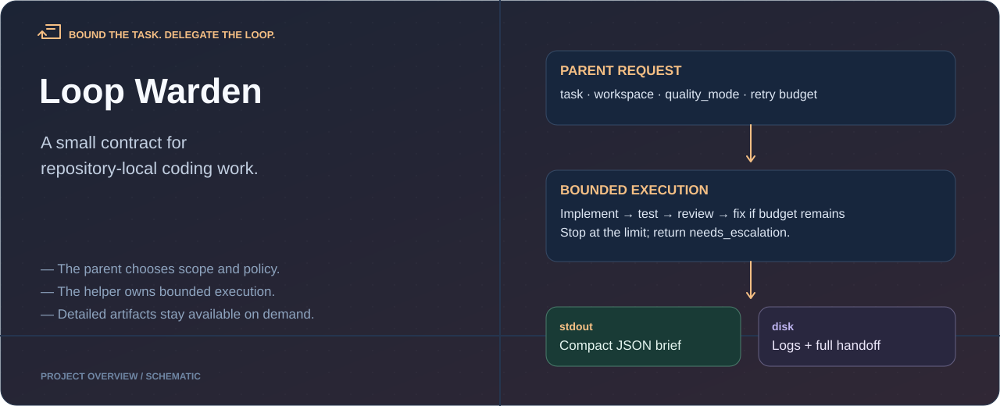
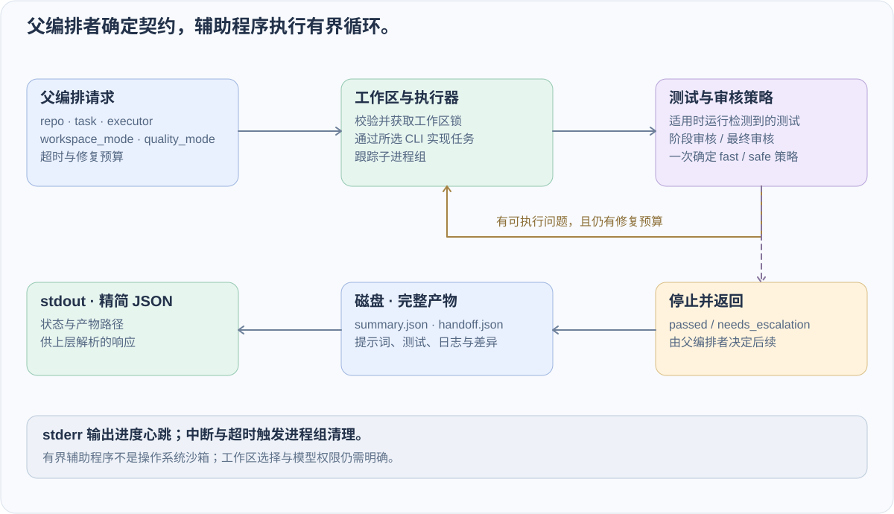

<div align="center">



# Loop Warden · 有界 AI 编码委派

**父编排者定义任务边界，辅助程序管理有界执行循环。**

[](LICENSE)

[English](README.md) · **简体中文**

[查看入口](#先看边界再运行委派) · [任务契约](#先有任务契约再启动执行器) · [质量模式](#质量模式) · [交接](#两级交接)

</div>

把顶层 Agent（比如 Hermes）和本地编码 CLI（`gemini`、`codex`）接在一起跑多步任务时，最容易栽在三件很具体、很烦人的工程破事上：

1. **僵尸子进程**：子 CLI 卡在管道或者超时被掐掉后，它拉起的整串子进程组还留在后台吃资源。
2. **上下文爆炸**：子任务跑完把完整的实现日志、测试输出和 Review Diff 一股脑全打回 `stdout`，一轮就吃掉主 Agent 七八千 token。
3. **弱模型死循环**：轻量模型在同一个 Review 问题上反复改、反复挂，把重试额度烧光，而上层 Agent 根本不知道该什么时候接管。

**Loop Warden**（`delegate_coding_cli.py`）就是从我日常的 Hermes 编码工作流里抽出来的本地“督工”脚本：**父级 Orchestrator 只负责定下任务契约和边界，这个 helper 负责把“实现 → 跑测 → Review → 有限轮修复”的机械闭环跑完**。跑完（或触及熔断上限）后，它在 `stdout` 只吐一份约 320 token 的 JSON 简报，把大体积日志全留在磁盘目录里按需翻阅。

## 先看边界，再运行委派

```bash
git clone https://github.com/dubianche123/coding-agent-supervisor.git
cd coding-agent-supervisor
python3 -B scripts/delegate_coding_cli.py --help
python3 -B scripts/delegate_coding_cli.py --check-health
```

`--help` 用来查看 CLI 契约，`--check-health` 用来检查当前活跃子进程数和工作区锁，都不会启动任何大模型。

## 先有任务契约，再启动执行器

靠谱的委派不能只传一句模糊的自然语言，而是要先定好契约：目标仓库路径、工作区隔离方式（`direct`、`worktree` 或 `copy`）、执行器（`gemini` 或 `codex`）、质量档位（`auto`、`fast` 或 `safe`）以及最多允许自修复几轮（`max_fixup_rounds`）。

将下面的内容保存为 `/tmp/delegate-request.json`（把 `repo` 换成至少有一次 Git 提交的本地仓库路径）：

```json
{
  "repo": "/absolute/path/to/task-repo",
  "task": "修复请求失败后的登录加载状态，并加入一个聚焦的回归检查。",
  "executor": "gemini",
  "mode": "implement",
  "workspace_mode": "direct",
  "quality_mode": "safe",
  "stdout_mode": "brief",
  "timeout": 1800,
  "max_fixup_rounds": 2
}
```

```bash
python3 -B scripts/delegate_coding_cli.py --request-json /tmp/delegate-request.json
```

| 父编排者决定 | 辅助程序强制执行 | 上层收到什么 |
| --- | --- | --- |
| 任务与目标仓库 | 路径安全校验、Git HEAD 检查与工作区互斥锁 | 实际工作区与产物目录路径 |
| 执行器与 `quality_mode` | 自动跑测、分级 Step/Final Review、子进程组追踪 | 结构化问题列表、测试结果与尝试轮数 |
| 超时与修复轮数上限 | 有限轮自修复 + 退出/超时自动回收进程组 | `passed` 或明确的 `needs_escalation` 升级信号 |
| 怎么处理代码 Diff | 绝不自动 push、merge 或部署 | 约 320 token 的 `stdout` 简报 + 磁盘上可按段落读取的 `handoff.json` |

## 运行时架构



[详细 C4 运行时视图](docs/c4-delegation-flow.svg)

这张 C4 风格图把三层职责分开：

- **父级 orchestrator**：定义任务边界，并在 helper 结束后决定 apply、retry 或 escalate。
- **确定性 helper**：负责 workspace lock、模型路由、重试上限、heartbeat 和结构化 handoff。
- **模型驱动 CLI**：负责实现和 review，但只能在 helper 的有界策略内运行。

这个设计让 stdout 专门留给最终 JSON brief，stderr 专门放进度 heartbeat，详细日志则落盘，按需读取。

## 解决什么问题

本地 coding-agent 工作流经常栽在一些无聊但很痛的地方：

| 问题 | 常见故障 | 这个 helper 的做法 |
|:--|:--|:--|
| 进程泄漏 | 子 CLI 在中断、超时或 pipe 卡住后残留 | 跟踪进程组，并在 timeout、shutdown、cleanup 时回收 |
| token 膨胀 | orchestrator 读完整日志、review 输出和大 handoff JSON | stdout 只打印紧凑 brief，细节留在磁盘 |
| 缺少可见性 | 长时间运行时终端看起来像卡死 | 把 progress heartbeat 写到 stderr，不污染 stdout JSON |
| 弱模型循环 | fast/flash 模型反复修同一个 review 问题 | 到达 fixup 边界后停止，并向父级发出 `needs_escalation` |
| review 策略临时化 | 每一步都让 orchestrator 重新判断 | `quality_mode` 每轮解析一次，然后执行确定性策略 |

## 核心行为

helper 把职责拆开：

- **实现**：默认使用 Gemini CLI 的 `gemini-3-flash-preview`；也可以显式选择 Codex CLI。
- **step review**：默认使用 `gemini-3.1-flash-lite-preview`，用于常规检查和 fixup 决策。
- **final review**：safe mode 使用 `gemini-3.1-pro-preview`；fast mode 先走轻量路径，只有风险足够时才升级。
- **父级升级**：如果 fixup 次数耗尽但 review 仍失败，helper 不会自己升级模型，而是返回 `needs_escalation`，让 Hermes 用更强模型重新提交。

## 不读全量日志，怎样接住结果

1. 将 stdout 按 JSON 解析，先看 `success`、`handoff_status`、`followup_required` 和 `escalation_required`。
2. 通过时，检查返回的变更文件与相关测试/审核证据。
3. 返回 `needs_escalation` 时，读取问题和尝试历史，再由父编排者决定增强执行器，还是缩小任务。
4. 只读取需要诊断的阶段日志；stderr 心跳代表进度，不是最终结果。

`passed` 记录的是辅助程序的执行/审核结论，不表示变更已经合并、部署，或在所有环境下完成验证。

## 执行流程

1. 校验目标仓库和 workspace 模式。
2. 创建或选择受控 workspace。
3. 构建受限 delegation prompt。
4. 通过 Gemini CLI 或 Codex CLI 执行实现。
5. 在合理范围内运行检测到的测试。
6. 按策略执行 step review。
7. 在 review 发现可修复问题时，执行有边界的 fixup 轮次。
8. 如果 fixup 次数耗尽且 review 仍失败，返回 `needs_escalation`。
9. 否则根据 `quality_mode` 执行 final review。
10. 写入 `orchestrator_brief.json`、`summary.json`、`handoff.json` 和日志。
11. 将最终 stdout payload 作为合法 JSON 打印出来。

## Progress Heartbeat

当 `stdout_mode` 是 `brief` 时，stdout 必须保持可机器解析。因此进度消息只写到 stderr：

```text
[Heartbeat] Starting Workspace: Preparing direct workspace for /path/to/repo.
[Heartbeat] Generating Implementation: Round 1: running gemini implementation.
[Heartbeat] Running Tests: Round 1: detecting and running configured tests.
[Heartbeat] Step Review [1]: Running first-pass review with gemini-3.1-flash-lite-preview.
[Heartbeat] Fixup Attempt [1]: Running targeted fixup with gemini.
[Heartbeat] Final Review: Running final review in safe mode.
[Heartbeat] Cleanup: Reaping active child processes after implementation run.
```

这样人和日志都能看到实时进度，同时 stdout 仍然只留给下游 JSON 解析。

## 两级交接

默认 stdout payload 很小：

```json
{
  "success": true,
  "handoff_status": "passed",
  "followup_required": false,
  "escalation_required": false,
  "next_recommended_action": "Inspect the reported diff and logs, then ask before applying, committing, pushing, or deploying.",
  "paths": {
    "handoff": ".hermes/delegate-runs/<timestamp>/handoff.json",
    "summary": ".hermes/delegate-runs/<timestamp>/summary.json",
    "brief": ".hermes/delegate-runs/<timestamp>/orchestrator_brief.json"
  }
}
```

完整产物保存在：

```text
.hermes/delegate-runs/<timestamp>/
```

orchestrator 只读取自己需要的 section：

```bash
python3 -B scripts/delegate_coding_cli.py --read-handoff .hermes/delegate-runs/<timestamp>/handoff.json --section findings
python3 -B scripts/delegate_coding_cli.py --read-handoff .hermes/delegate-runs/<timestamp>/handoff.json --section tests
python3 -B scripts/delegate_coding_cli.py --read-handoff .hermes/delegate-runs/<timestamp>/handoff.json --section changed_files
```

可用 section 包括 `brief`、`findings`、`tests`、`changed_files`、`attempts`、`logs` 和 `full`。

## 运行产物

每次 helper run 都会把中间文件写到：

```text
<workspace>/.hermes/delegate-runs/<timestamp>/
```

最终 stdout brief 里会包含准确的 `paths.log_dir`、`paths.summary` 和 `paths.handoff`。最常用的文件如下：

| 文件 | 含义 |
|:--|:--|
| `delegate_prompt.md` | 发给 executor 的初始实现 prompt。 |
| `delegate_prompt_round_N.md` | 第 `N` 轮 fixup 的实现 prompt。 |
| `implementation.stdout.log` / `implementation.stderr.log` | 最新一轮 implementation executor 输出。 |
| `implementation_round_N.stdout.log` / `implementation_round_N.stderr.log` | 第 `N` 轮 fixup 的 implementation executor 输出。 |
| `tests.json` | 最新一轮检测到的测试结果。 |
| `tests_round_N.json` | 第 `N` 轮 fixup 的测试结果。 |
| `gemini_review_prompt.txt` | 最新 step review prompt。 |
| `gemini_review.stdout.log` / `gemini_review.stderr.log` | 最新 step review 输出，通常来自 `gemini-3.1-flash-lite-preview`。 |
| `gemini_review_round_N.stdout.log` / `gemini_review_round_N.stderr.log` | 第 `N` 轮 fixup 的 step review 输出。 |
| `gemini_review_pro.stdout.log` / `gemini_review_pro.stderr.log` | step review 升级到 pro 确认时的输出。 |
| `gemini_review_pro_round_N.stdout.log` / `gemini_review_pro_round_N.stderr.log` | 第 `N` 轮 fixup 的 step review pro 确认输出。 |
| `gemini_final_review_flash.stdout.log` / `gemini_final_review_flash.stderr.log` | fast mode 下 final flash-lite review 的输出。 |
| `gemini_final_review.stdout.log` / `gemini_final_review.stderr.log` | safe mode 的 final pro review 输出，或 fast final review 升级到 pro 后的输出。 |
| `orchestrator_brief.json` | 给父级 orchestrator 消费的紧凑 payload。 |
| `summary.json` | 完整运行摘要，包含模型路由和产物路径。 |
| `handoff.json` | 用于 follow-up、escalation 或细节检查的结构化 handoff。 |

## Token 效率指标

每次完成的 run 都会在 `token_efficiency` 里记录启发式 token 估算：

```json
{
  "token_efficiency": {
    "orchestrator_stdout": {
      "brief_estimated_tokens": 320,
      "full_summary_estimated_tokens": 7800,
      "estimated_tokens_saved_vs_full_summary": 7480,
      "estimated_reduction_vs_full_summary": 0.959
    },
    "artifact_io": {
      "by_category": {
        "implementation_prompts": { "estimated_tokens": 1800 },
        "step_review_outputs": { "estimated_tokens": 420 },
        "final_pro_outputs": { "estimated_tokens": 260 }
      }
    }
  }
}
```

这些数字是估算，不是供应商账单。估算规则是：中文字符除以 1.5，其它字符除以 4。它主要回答两个实际问题：

- compact stdout 相比读取完整 summary 或 handoff，到底给 orchestrator 省了多少上下文？
- 哪个阶段制造了最多 prompt/output 体积：implementation、flash-lite review，还是 pro review？

精确模型成本仍然要看供应商 usage 或 billing log。路由决策上，可以先用这些估算做预警：如果某类任务几乎不省，下一次 Hermes 就应该直接处理。

## Dynamic Escalation Signal

helper 是有边界的。如果 step review 在 fixup 预算耗尽后仍然失败，helper 会停止并返回：

```json
{
  "success": false,
  "handoff_status": "needs_escalation",
  "followup_required": true,
  "escalation_required": true,
  "next_recommended_action": "Task exceeded max fixup attempts with current executor. Recommend escalating to a stronger model (e.g., gemini-3.1-pro-preview) and resubmitting the task."
}
```

具体触发原因会写入 `summary.json` 的 `error`、`escalation_reason` 和 `escalation_error`。helper 不在内部自动升级模型；这个判断属于父级 orchestrator。

## 质量模式

| 模式 | 行为 |
|:--|:--|
| `auto` | 根据任务风险信号一次性解析成 `fast` 或 `safe` |
| `fast` | 尽量少做 step review；final review 先走 flash-lite，只有风险足够才调用 pro |
| `safe` | 默认运行 step review，允许高风险 step review 找 pro 确认，并且 final review 默认使用 pro，除非 circuit breaker 先停止 |

## 委派边界

delegation 不是免费的。只有当实现和 review 节省下来的上下文，大于 orchestrator 调度开销时，helper 才真正划算。

一行修改、小 README 调整、git/admin 操作、问答解释，以及大概率只改 1-2 个文件且少于约 50 行的 targeted fix，优先让 Hermes 直接处理。

预计 3 个以上文件、约 100 行以上变更/生成、需要测试循环、广泛调试、跨文件重构、大型 code review，或用户明确要求运行 bounded Gemini/Codex helper 时，才优先 delegation。

中等任务用 `quality_mode: fast`，让 pro 尽量少出现。只有 final pro review 确实值得付费时，才用 `quality_mode: safe`。

## 安装与请求字段参考

把 skill 安装到 Hermes：

```bash
mkdir -p ~/.hermes/skills/devops
cp -R . ~/.hermes/skills/devops/delegate-coding-cli
chmod +x ~/.hermes/skills/devops/delegate-coding-cli/scripts/delegate_coding_cli.py
```

运行依赖：**Python 3**、**Git**，以及至少一个已配置的执行器（**Gemini CLI** 和/或 **Codex CLI**）。

`--request-json` 核心字段说明：

| 字段 | 可选值 | 说明 |
|:--|:--|:--|
| `mode` | `plan`, `implement`, `review` | `plan` 与 `review` 只读；`implement` 允许修改工作区代码 |
| `executor` | `auto`, `gemini`, `codex` | 默认 `gemini`（`gemini-3-flash-preview`）；`codex` 默认使用 `gpt-5.4-mini` |
| `quality_mode` | `auto`, `fast`, `safe` | 每次运行一次性解析，决定 Step Review 与 Final Review 的深度 |
| `workspace_mode` | `direct`, `worktree`, `copy` | `direct` 要求目标目录是已有 `HEAD` 提交的 Git 仓库；`worktree` 与 `copy` 提供隔离工作区 |
| `review` | `auto`, `always`, `never` | 严格枚举——跳过审核请传 `"never"`（传 `"none"` 或 `"off"` 会直接报错拒绝） |
| `stdout_mode` | `brief`, `summary`, `full` | 给上层 Agent 消费请保持默认 `brief`；`full` 仅用于人工排障 |
| `max_fixup_rounds` | 非负整数 | 允许内部自修复的最大轮数，超限后触发熔断并返回 `needs_escalation` |

## 可平移性

核心 helper 可以平移给 Codex CLI 或 Gemini CLI 使用，因为它本质上只是一个接收 request JSON、输出机器可读产物的 Python 入口。调用方只需要创建 request 文件，然后运行：

```bash
python3 -B scripts/delegate_coding_cli.py --request-json /tmp/delegate-request.json
```

Hermes 特有的是 skill 包装层，以及“什么时候应该调用它”的指令风格。要给另一个 CLI 使用同一套设计，只需要补一个很薄的 wrapper prompt 或命令约定：

- 写入 request JSON；
- 启动 `delegate_coding_cli.py`；
- 把 stdout 当作 compact brief 读取；
- 只有需要细节时再读取 `handoff.json` 的 section；
- 当父级 CLI 和 executor CLI 是同一个工具时，避免递归委派循环。

所以实践上，Codex CLI 或 Gemini CLI 现在就可以把它当作本地 helper 调用。要把它变成另一个 agent 环境的一等 skill，主要是重写包装指令，而不是重写 Python 执行引擎。

## 安全边界

helper 默认保守运行：

- 拒绝过大或敏感的仓库路径。
- 不 push、merge、deploy 或 publish。
- 在调用子 CLI 前清理敏感环境变量。
- prompt 先写入文件，再用 subprocess 调用，不拼 shell 字符串。
- 使用 workspace lock，避免两个 helper 同时改同一个 workspace。
- 跟踪子进程组，并在 timeout、interrupt、shutdown 时清理。

## 从实现看执行边界

仓库刻意保持很小。阅读 [delegate_coding_cli.py](scripts/delegate_coding_cli.py) 时，可以按这些函数定位职责：

| 函数 | 回答什么问题 |
| --- | --- |
| `normalize_request()` | 请求中的哪些值和默认值实际生效？ |
| `resolve_quality_mode()` | `auto` 怎样确定为 `fast` 或 `safe`？ |
| `create_workspace()` / `acquire_workspace_lock()` | 工作在哪里执行，并发占用如何控制？ |
| `run_implementation_round()` / `run_final_review_round()` | 哪些实现与审核调用会发生？ |
| `terminate_process_group()` / `cleanup_active_processes()` | 超时和中断后怎样清理子进程？ |
| `build_orchestrator_brief()` / `build_handoff_section()` | 上层先读什么，怎样按需读取详情？ |

[SKILL.md](SKILL.md) 是 Hermes 选择与调用该工具的包装说明；执行引擎本身是 Python 入口，其他编排者可以复用请求与摘要契约。

## 仓库结构

```text
.
├── SKILL.md
├── README.md
├── README_CN.md
├── LICENSE
├── docs
│   └── c4-delegation-flow.svg
└── scripts
    └── delegate_coding_cli.py
```

## 项目状态

这是从活跃 Hermes 工作流里抽出来的 MVP。目标不是替代高层 orchestrator，而是把本地执行层做得有边界、可观察、易交接。
